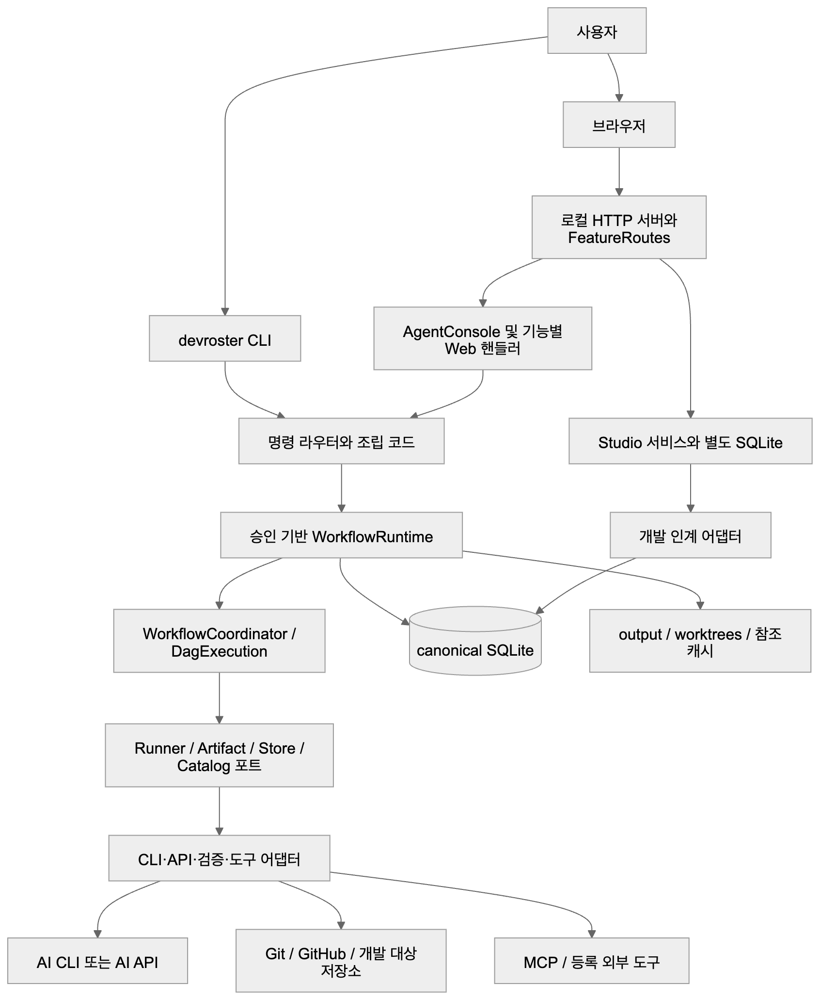
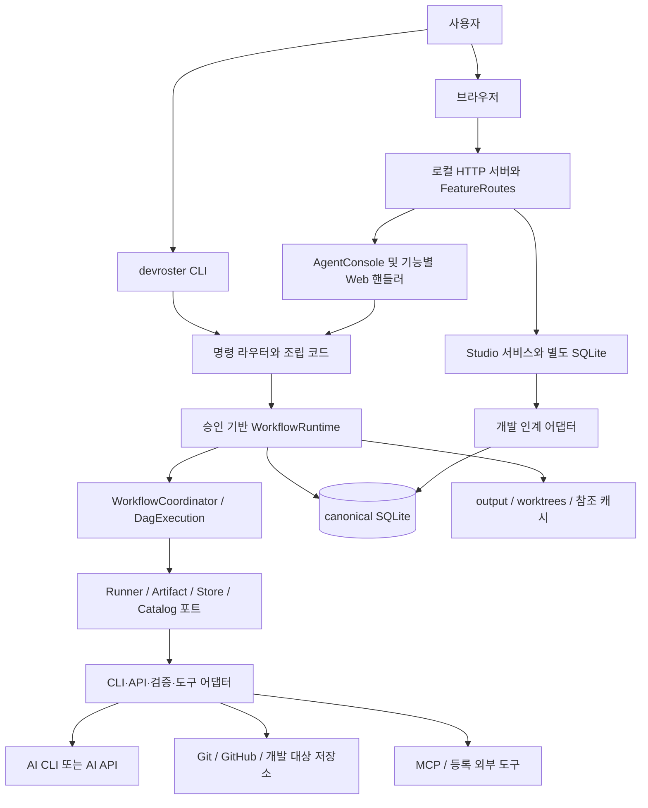
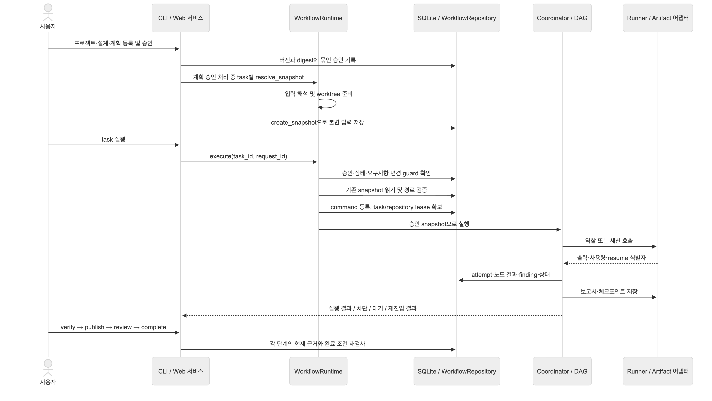
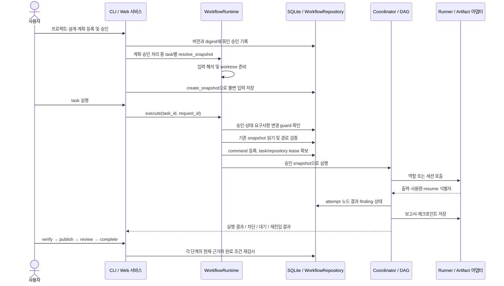
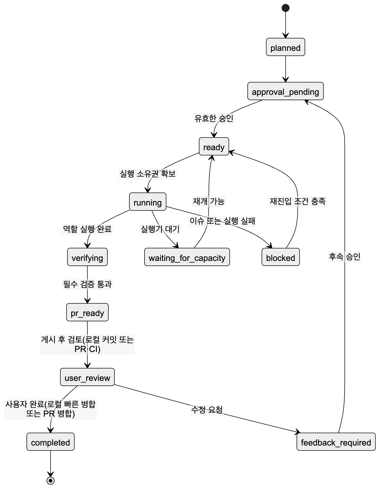
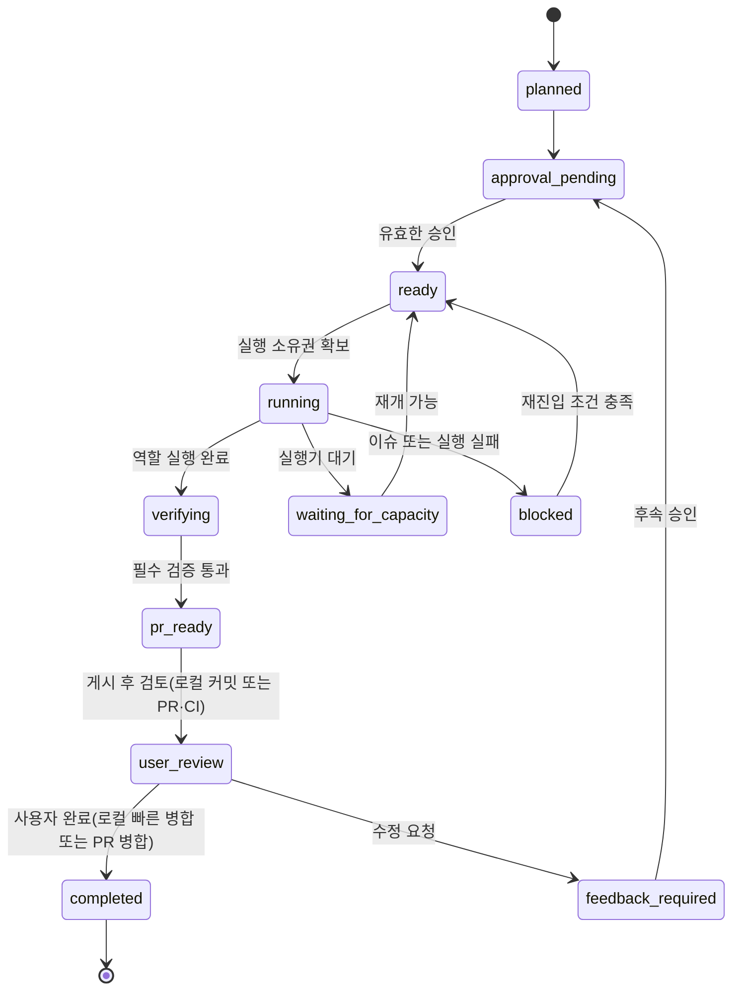
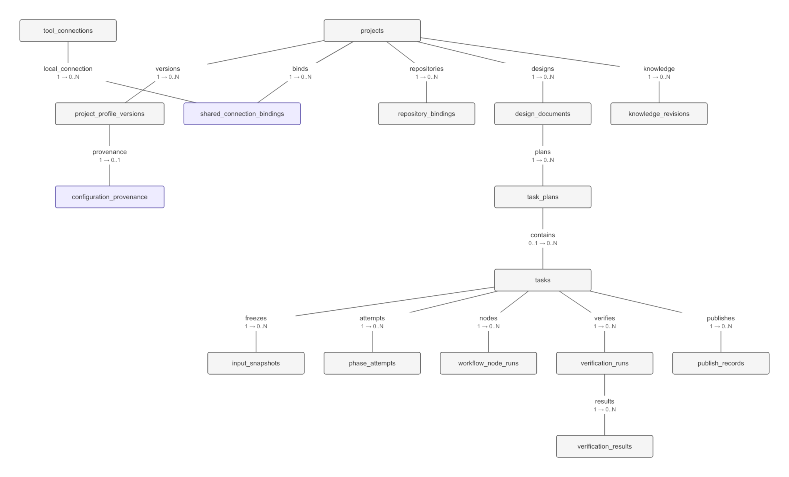
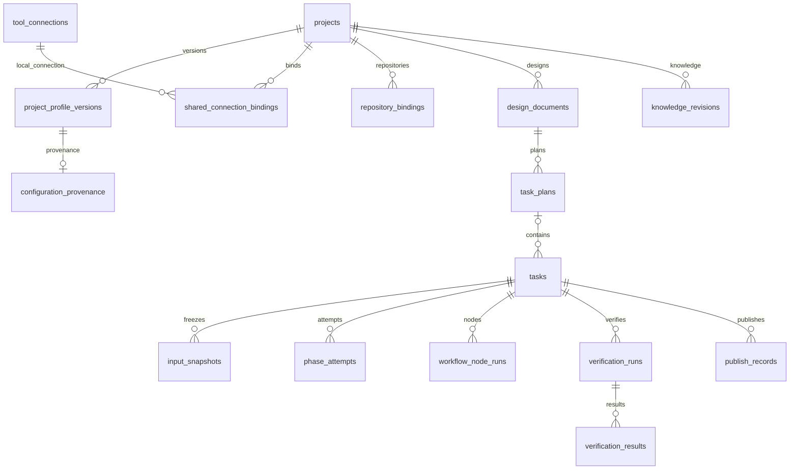

# DevRoster 통합 아키텍처

> 현재 구현을 관리하는 정본. 사용자 가이드는 사용 절차를, ADR은 결정 이유를, 이 문서는 모듈 책임·실행 흐름·데이터·변경 영향을 설명한다.

| 항목 | 기준 |
|---|---|
| 기준 | 버전 0.4.4의 `main`. 절마다 현재 소스·SQL·테스트 계약과 대조해 쓴다 |
| 대상 | `agent_dev/`, `config/`, `tests/`, 패키지 진입점 및 관련 운영 문서 |
| 확인 방법 | Python 소스·SQL·테스트 계약 대조 |
| 문서 책임 | 아키텍처 경계 변경 시 Architect, 저장 구조 변경 시 DBA, 최종 문서 반영 시 Tech Writer |
| 우선순위 | 현재 코드·스키마 → 이 문서의 현재 구현 설명. 과거 설계안·계획은 구현 완료의 증거로 사용하지 않음 |

도식은 Mermaid 지원 여부와 관계없이 볼 수 있도록 PNG로 표시한다. 확대용 SVG와 수정용 Mermaid 원본도 함께 제공한다.

## 목차

1. [시스템 경계와 전체 구조](#system)
2. [계층과 모듈 책임](#modules)
3. [진입점과 실행 엔진 선택](#entrypoints)
4. [승인 기반 작업의 전체 흐름](#execution)
5. [상태·승인·완료 조건](#lifecycle)
6. [Workflow·세션·재진입](#workflow)
7. [입력 스냅샷·컨텍스트·위키·스킬](#context)
8. [AI 실행기·모델·사용량](#runners)
9. [데이터 모델과 트랜잭션](#data)
10. [저장 위치와 설정 소유권](#storage)
11. [동시성·격리·오류 처리](#safety)
12. [Studio와 개발 인계](#studio)
13. [개발 검토·추적성·요구사항 변경](#review)
14. [외부 도구·디자인 참고·소스 그래프](#integrations)
15. [레거시 제거와 남은 이전 도구](#legacy)
16. [변경 영향과 검증 지도](#maintenance)
17. [현재 운영 관측과 계획의 구분](#observations)
18. [문서 갱신 규칙과 관련 문서](#documents)

<a id="system"></a>
## 1. 시스템 경계와 전체 구조

DevRoster는 **로컬 Python 애플리케이션 안에서 개발 작업을 승인·실행·검증하는 도구**다. UI, CLI, AI CLI/API, Git 작업 폴더, SQLite를 연결한다. 개발 대상 프론트엔드·백엔드 저장소는 등록된 대상일 뿐 DevRoster 서버의 내부 계층이 아니다.



[SVG로 확대 보기](assets/architecture/01-system-overview.svg)

<details>
<summary>Mermaid 원본</summary>



</details>

- 배포 단위: `agent_dev` Python 패키지. Python 3.11+, 필수 외부 런타임 의존성은 `pyproject.toml` 기준 없음. AI CLI·Git·선택 기능의 실행 도구는 별도로 준비한다.
- 데스크톱 진입점은 loopback HTTP 서버를 시작하고 브라우저를 연다. 실행 경로는 승인 기반 Workflow 하나다. 레거시 파이프라인·마스코트·Discord 명령 리스너는 제거했다(ADR 0003).
- 핵심 상태는 SQLite, 큰 본문·로그·보고서·Git 변경은 파일에 둔다. 둘 사이에는 일반적인 단일 ACID 트랜잭션이 없다.
- Workflow는 로컬 실행을 전제로 한다. 한 작업 안의 DAG 스케줄러는 실행 가능 노드를 순서대로 처리한다. 서로 다른 저장소(모듈)의 작업은 각자 자기 저장소만 잠그므로 동시에 실행할 수 있다(§11). 분산 실행은 보장하지 않는다.
- 결정 근거: [로컬 Workflow 엔진 ADR](adr/0001-local-workflow-engine.md), [역할 세션 ADR](adr/0002-four-session-pipeline.md).

<a id="modules"></a>
## 2. 계층과 모듈 책임

승인 기반 경로는 `application → domain/ports` 의존 방향을 갖는다. 실제 I/O 구현과 조립은 `adapters/`에 있다. 레거시 `pipeline/`·`quality/`·레거시 CLI는 제거했고, v2가 쓰는 공용 기반만 남겼다(§15).

| 영역 | 책임 | 주요 소스 |
|---|---|---|
| 진입점 | 앱 실행·명령 분기·짧은 별칭, 앱 홈 격리 | [fa.py](../agent_dev/fa.py), [entrypoints.py](../agent_dev/entrypoints.py), [app.py](../agent_dev/app.py) |
| application | 실행 조정, DAG 진행, 설계 평가, Studio 업무 규칙 | [workflow.py](../agent_dev/application/workflow.py), [workflow_dag.py](../agent_dev/application/workflow_dag.py), [design.py](../agent_dev/application/design.py), [studio.py](../agent_dev/application/studio.py) |
| domain | 상태 전이·계약, 역할 권한, 그래프 검증, 세션 파싱, 모델/컨텍스트/사용량 정책 | [domain/](../agent_dev/domain/) |
| ports | 실행기·상태·산출물·카탈로그의 인터페이스 | [ports/](../agent_dev/ports/) |
| 조립 및 실행 | 프로필·권한·worktree·실행기·스토어 조합 | [workflow_runtime.py](../agent_dev/adapters/workflow_runtime.py), [command_line.py](../agent_dev/adapters/command_line.py) |
| canonical 저장 | 트랜잭션·상태·승인·attempt·lease·이벤트 | [state/sqlite/](../agent_dev/adapters/state/sqlite/) |
| 실행 경계 | AI CLI/API, 역할별 파일 통제, 도구 호출, 검증, 게시 | [cli_runner.py](../agent_dev/adapters/cli_runner.py), [api_runner.py](../agent_dev/adapters/api_runner.py), [role_execution.py](../agent_dev/adapters/role_execution.py), [verification.py](../agent_dev/adapters/verification.py), [publishing.py](../agent_dev/adapters/publishing.py) |
| 제품 기능 | 프로젝트 설정, Studio 인계, 개발 검토, 추적성, 변경 관리, 위키, 소스 탐색, 연결 관리 | [adapters/](../agent_dev/adapters/) — 각 기능은 아래 절에서 연결 |
| UI | HTTP 라우팅·검증·정적 HTML/CSS/JS, 공통 진행바(`ui-progress.js`) | [ui/](../agent_dev/ui/) |
| 공용 실행 기반 | 제공자 CLI 프로세스·출력·사용량 파싱, 프로세스 기록, Git 게시 유틸 | [runners/](../agent_dev/runners/), [process_registry.py](../agent_dev/storage/process_registry.py), [git_publish.py](../agent_dev/scm/git_publish.py) |
| 공통·기본값 | 경로/출력/환경, 설정 항목, 번들 역할·프리셋·템플릿, 레거시 자료 가져오기 | [core/](../agent_dev/core/), [config/](../agent_dev/config/), [defaults/](../agent_dev/defaults/), [templates/](../agent_dev/templates/), [migration/](../agent_dev/migration/) |

핵심 교환 계약은 [contracts.py](../agent_dev/domain/contracts.py)의 `Command`, `TaskRecord`, `PhaseRequest`, `PhaseResult`, `GateResult`, `ToolConnection`이다. `PhaseRequest`는 snapshot digest·generation·capabilities와 세션 `node_ids`/`resume_session`을 전달한다. `GateResult`의 필수 결과가 하나 이상 있고 모두 통과해야 `aggregate_gates()`가 참이다.

<a id="entrypoints"></a>
## 3. 진입점과 실행 엔진 선택

| 진입점 | 라우팅 / 책임 |
|---|---|
| `devroster`, `fa` | `fa.main()` → 격리 환경 적용 → `app` 또는 `entrypoints.main()` |
| `agent-dev`, `python -m agent_dev` | `entrypoints.main()` → canonical `command_line`. `run`·`verify`·`resume`·`complete`는 `task` 명령, `status`는 `task list`의 짧은 형태. 그 밖의 옛 명령은 `Unknown command`로 종료(exit 2) |
| `devroster app`, `devroster-app` | `app.main()` → 명시/기억된 root 선택 → loopback 서버 → 미설정 `/setup`, 설정됨 `/agent`. 기본 8767, 충돌 시 빈 포트 |
| `studio`, `setup --web`, `dashboard` | 각 서버가 공통 기능 라우트를 탑재. 화면 진입점이 달라도 해당 업무 서비스를 사용 |
| 웹 작업실 `/agent` | `AgentConsole.prepare/preview/start` → 허용된 작업을 canonical 명령 파서·서비스로 전달. 쓰기는 POST 실행 작업으로 처리 |

**실행 형식 분기**: `WorkflowCoordinator.execute()`가 snapshot의 `workflow_graph`와 `workflow_legacy`를 확인해 DAG 또는 순차 실행을 선택한다. `workflow_legacy`는 그래프 없이 phase 목록만 있던 프로필을 canonical 스토어에서 순서대로 실행하는 호환 형식이며, 제거한 레거시 파이프라인과는 다르다.

| `orchestrator_v2` 플래그 | 의미 |
|---|---|
| `read` | canonical 조회 허용 |
| `dual_write` | 레거시 쓰기 경로 제거로 효과 없음. 옛 설정 파일과의 호환을 위해 값만 기록 |
| `execute` | 승인 기반 실행 허용. 실제 작업의 승인·상태·권한 검사는 별도 |
| `publish` | 실제 canonical 게시 허용. dry-run과 실제 게시를 구분 |
| `legacy_readonly` | 레거시 쓰기 경로 제거로 효과 없음(값만 유지) |

웹은 `FeatureRoutes`가 Agent·Workflow·Integration·Reference·Navigation·Journey·Changes·Review·Source·Wiki·Messenger 라우트를 묶는다. `StudioWeb`은 Studio/Setup·정적 자산과 함께 서버에 탑재된다. 주요 화면은 `/home`, `/agent`(작업실, 이전 `/dashboard`는 302로 이동), `/review`, `/traceability`, `/changes`, `/workflows`, `/source`, `/integrations`, `/references`, `/wiki`, `/messengers`, `/setup`, `/settings`, `/studio`다. `/messengers`는 슬랙 채널을 주기 조회하는 리스너([messenger.py](../agent_dev/adapters/messenger.py))의 설정 화면이며, 리스너는 허용한 작성자의 명령만 기존 CLI·작업실·Studio 경로로 넘긴다([설계](design/slack-messenger.md)). 앱은 시작할 때 패키지 파일의 stamp를 기록하고, `/api/app/status`가 디스크와 다르면 공통 내비게이션이 모든 화면에 재시작 안내를 띄운다([code_stamp.py](../agent_dev/ui/code_stamp.py)). `/settings`는 공통 기본값·프로젝트 반영·공통 MCP 연결·저장 위치를 관리하며 `SetupWeb`의 `/api/settings/` 읽기/쓰기 경로를 사용한다. **CLI 기능 추가가 웹 노출을 자동으로 추가하지는 않는다.**

소스: [feature_routes.py](../agent_dev/ui/feature_routes.py), [studio_server.py](../agent_dev/ui/studio_server.py), [setup_server.py](../agent_dev/ui/setup_server.py), [settings.html](../agent_dev/ui/assets/settings.html), [settings.js](../agent_dev/ui/assets/settings.js), [agent_console.py](../agent_dev/adapters/agent_console.py).

<a id="execution"></a>
## 4. 승인 기반 작업의 전체 흐름



[SVG로 확대 보기](assets/architecture/04-task-execution.svg)

<details>
<summary>Mermaid 원본</summary>



</details>

| 단계 | 처리와 보존 근거 | 담당 소스 |
|---|---|---|
| 준비 | 프로젝트·repository binding·AI·검증 설정 진단. 설계의 범위·수용 기준·제약 확인. 저장한 적 없는 프로젝트는 빌드 파일(package.json·pyproject·pom/gradle)이 하나로 가리키는 기술 프리셋으로 시작하고, 이 컴퓨터의 첫 프로젝트는 저장할 때 AI 도구를 공통 AI 도구로 만든다 | [project_setup.py](../agent_dev/adapters/project_setup.py), [preparation.py](../agent_dev/adapters/preparation.py), [design.py](../agent_dev/application/design.py) |
| 승인 | 설계 revision과 계획 digest 승인. task 의존성과 상태 검사 | [store.py](../agent_dev/adapters/state/sqlite/store.py) |
| 입력 고정 | 계획 승인 명령에서 task별 프로필·역할·Workflow·정책·도구·위키·worktree binding을 해석하고 불변 snapshot 저장. 인계 모듈이 정해진 task는 그 저장소만 snapshot·worktree·lease 대상(PR #34) | `WorkflowRuntime.resolve_snapshot()`, `WorkflowRepository.create_snapshot()` |
| 실행 | 중복 요청 검사, lease, attempt/generation 기록 → 노드/세션 실행 → Harness·역할 정책 확인 | `WorkflowRuntime.execute()`, `WorkflowCoordinator`, `DagExecution` |
| 재시도·재진입 | 기존 snapshot 사용. 실패·finding의 범위와 generation을 기록하고 필요한 노드 재실행. Workflow 검증 노드의 필수 명령이 실패하면 실패 출력과 함께 Developer로 재진입(§6) | `workflow.py`, `workflow_dag.py`, `store.py` |
| 검증 | 승인된 argv 명령·cwd·시간/출력 제한, 소스/commit 변경 여부, 필수 gate·테스트 근거 저장. AI 도구 샌드박스가 막은 빌드·테스트는 역할이 "미실행"으로 기록하고 이 단계가 실제로 실행 | [verification.py](../agent_dev/adapters/verification.py), [phase_catalog.py](../agent_dev/adapters/phase_catalog.py) |
| 게시·완료 | 완료 방식은 snapshot의 `completion.mode`(ADR 0003). **로컬(기본)**: 게시 = 작업 브랜치 커밋, 리뷰 = 커밋 불변·작업 폴더 깨끗, 사용자 완료 승인 때 기본 브랜치 빠른 병합(기본 브랜치가 움직였거나 그 체크아웃에 미커밋 변경이 있으면 거부). **GitHub(선택)**: commit/push/PR, 지정 CI 확인, PR 병합 후 완료. ADR 0003 이전 snapshot은 지정 CI가 있으면 GitHub | [publishing.py](../agent_dev/adapters/publishing.py), [ADR 0003](adr/0003-v2-primary-path.md) |
| 단계 승인 메모 | 워크플로 게이트 승인·반려에 메모(결정 사항)를 남기면 이후 역할 context의 `user_decisions`로 전달. 설계 공백은 Developer가 Architect로 재진입 | [store.py](../agent_dev/adapters/state/sqlite/store.py) `approve_node`, [artifacts.py](../agent_dev/adapters/artifacts.py) |

snapshot은 계획 승인 처리에서 만들어지는 실행 입력의 정본이다. `execute()`는 이미 저장된 snapshot을 사용한다. 이후 프로필·역할·위키를 수정해도 이미 고정된 실행 입력을 조용히 바꾸지 않는다. 변경된 요구사항은 별도의 변경 관리와 새 승인 경로를 따른다.

<a id="lifecycle"></a>
## 5. 상태·승인·완료 조건

상태 정의는 [status.py](../agent_dev/domain/status.py), 허용 전이는 [transitions.py](../agent_dev/domain/transitions.py), 실제 근거 검사는 스토어·실행·검증·게시 어댑터에 있다. 아래는 주 경로와 대표 복구 경로다. 모든 허용 전이를 그린 표는 아니다.



[SVG로 확대 보기](assets/architecture/05-task-lifecycle.svg)

<details>
<summary>Mermaid 원본</summary>



</details>

| 객체 / 상태 | 의미 |
|---|---|
| task | `planned`, `approval_pending`, `ready`, `running`, `blocked`, `waiting_for_capacity`, `verifying`, `pr_ready`, `user_review`, `feedback_required`, `completed`, `cancelled` |
| phase attempt | `queued`, `running`, `passed`, `failed`, `interrupted`, `superseded`, `waiting_for_capacity`. 동일 phase의 실행 이력을 덮어쓰지 않음 |
| 승인 | actor·대상 버전·digest에 결합. “과거에 한 번 승인됨”만으로 최신 입력을 승인한 것으로 취급하지 않음 |
| `pr_ready` | 필수 검증 정책 충족. PR 병합 또는 사용자 완료를 뜻하지 않음 |
| `user_review` | 게시 결과를 확인한 검토 단계. 로컬 완료는 게시 커밋이 HEAD이고 작업 폴더가 깨끗한지, GitHub 완료는 PR 상태·필수 CI를 확인 |
| `completed` | 완료 조건 충족. 로컬 완료는 사용자 완료 승인 때 기본 브랜치 빠른 병합, GitHub 완료는 PR 병합·필수 CI |

`publish()`는 검증 후 소스 digest가 바뀌면 게시하지 않는다. 로컬 완료에서는 작업 브랜치 커밋(`pr_number` 없음), GitHub 완료에서는 기존 PR 조회와 작업 식별자로 재시도를 복구한다. `review()`/`complete()`는 저장된 과거 성공만 사용하지 않고 현재 근거(로컬 HEAD·작업 폴더 상태 또는 GitHub PR·CI)를 확인한다. 로컬 코드 검토 결정과 완료는 서로 다른 기록이다.

<a id="workflow"></a>
## 6. Workflow·세션·재진입

| 구성 | 현재 구현 |
|---|---|
| 정의·버전 | 프로젝트별 Workflow 정의와 불변 버전. 저장·검사·미리보기·적용은 [workflow_definitions.py](../agent_dev/adapters/workflow_definitions.py) |
| 그래프 | `role`, `condition`, `merge`, `approval`, `verification`, `tool` 노드. 순환·연결·필수 역할·scope를 [workflow_graph.py](../agent_dev/domain/workflow_graph.py)에서 검사 |
| 역할 정책 | 역할의 capability와 경로 교집합을 snapshot에 저장. 사용자 정의 역할도 검증 대상 |
| 실행 | `DagExecution`이 선행 노드·승인·조건을 확인하고 실행. 노드별 실행/승인 기록은 `workflow_node_runs`, `workflow_node_approvals` |
| 세션 | 활성화된 역할 roster의 세션 정책에 따라 연속 역할을 한 번의 AI 호출로 묶음. AI 한 번 호출과 노드별 결과 저장은 별개 |
| 세션 설정 | 분석 `analysis`, 디자인 `design`, 개발 `develop`, 검증 `verify`, 문서 `docs`. 실제 노드 순서·포함 역할은 승인된 그래프/roster 기준 |
| 출력 계약 | 노드마다 `<<<NODE id>>>` … `<<<END NODE id>>>`, Harness Control JSON 정확히 1개. 노드 구간별 파싱·판정 |
| 이슈 | 앞 노드에서 이슈가 나면 후속 노드를 완료로 간주하지 않음. 범위가 확인된 재진입은 해당 노드와 영향을 받는 후속 경로를 갱신. QA·Reviewer·Security·Test Automation의 이슈는 Developer로, 설계 공백은 Developer가 Architect로 되돌림 |
| 검증 실패 재진입 | 검증(`verification`) 노드의 필수 gate가 실패하면 실패한 gate와 출력 끝부분(gate당 4,000자)을 `FindingDetected`로 남기고 `developer`(없으면 첫 `developer-*`)로 재진입. 같은 재시도 한도를 쓰며 소진 시 `VERIFICATION_FAILED`로 차단 |
| 복구 한도 | attempt·경과 시간·재진입 수, 같은 finding fingerprint의 반복 등을 제한. attempt 한도는 **AI 호출 수**로 센다: 재진입 때 다음 세대로 복사한 통과 기록(시작 이벤트 없음)과 세션의 한 호출을 나눠 받는 구성원 노드(`RunnerUsage.ai_call=false`)는 세지 않음. 누락된 세션 구간의 fallback도 무한 반복하지 않음 |
| 문서 역할 | Tech Writer는 코드·테스트 결함을 판정하지 않고 의견만 남긴다. 저장소의 테스트 보고서는 이전 실행의 것일 수 있고, 바로 뒤 검증 노드가 실제 명령을 실행한다 |

세션은 실행 시 각 노드의 `role_instruction`과 `output_contract`를 유지한다. 개발 가능 노드들의 허용 경로를 합친 실행 범위 안에서도 노드별 `changed_paths`를 검사한다. 읽기 전용 노드의 결과가 파일 변경 권한을 얻는 것은 아니다.

Claude/Codex의 실제 resume 식별자가 있으면 같은 제공자의 대화를 이어갈 수 있다. 이 경우 정적 컨텍스트 일부를 생략한다. resume가 불가능해 새 호출로 fallback할 때는 원래 전체 컨텍스트를 사용한다. 관련 계약: [session_output.py](../agent_dev/domain/session_output.py), [cli_runner.py](../agent_dev/adapters/cli_runner.py), [세션 ADR](adr/0002-four-session-pipeline.md).

<a id="context"></a>
## 7. 입력 스냅샷·컨텍스트·위키·스킬

### 7.1 승인 입력의 구성

`resolve_snapshot()`은 등록된 프로젝트 프로필과 허용된 task override를 합성하고 다음을 고정한다.

| 입력 묶음 | 고정 내용 / 경계 |
|---|---|
| 프로젝트·소스 | profile version, repository binding, 기준 ref·작업 worktree·허용 경로 |
| 실행 계획 | 승인 설계 본문, 그래프/phase 목록, role policy, 실행 한도·검증 정책 |
| 지시 | 번들 `defaults/AGENTS.md`·`CLAUDE.md` 및 역할 문서. 관리용 `.agent-dev/roles/<role>.md` override는 일반 UTF-8 파일·크기·symlink 검사 후 적용. 번들 규칙·역할·단계 안내는 범용이며, 프로젝트 도메인(저장된 roster 도메인 → Workflow의 FMEA Expert → `runtime.json`의 `project_profile`)에 맞는 도메인 팩 `defaults/domains/<도메인>/`이 역할·단계·프롬프트 사본과 AGENTS 부록(§12)을 더한다. 공통 원칙에 "AI 도구 실행 환경 제한으로 못 돌린 빌드·테스트는 issue가 아니라 미실행으로 기록"이 있다 |
| 모델·도구 | runner/model routing, 실행 capability, 프로젝트 연결·승인 grant·도구 schema binding |
| 참고 문맥 | 프로필 context/role context 정책, 기존 knowledge facts, 디자인 참고 자료, 역할별 위키 bundle |

프로젝트의 임의 `AGENTS.md`/`CLAUDE.md`를 승인된 역할 권한의 정본으로 승격하지 않는다. 일반 파일로 읽힌 저장소 문서·MCP 응답·위키 본문은 참고 데이터다. 자동 지시 로딩 차단과 AI가 파일을 읽을 수 있는지는 다른 경계다.

### 7.2 위키와 기존 지식의 구분

| 구분 | 정본 / 동작 |
|---|---|
| 기존 지식 | [governance.py](../agent_dev/adapters/governance.py)의 `knowledge_candidates`: 후보·확인·검색·deprecated 경로 |
| LLM 위키 | [wiki_knowledge.py](../agent_dev/adapters/wiki_knowledge.py)의 `knowledge_revisions`: candidate → 승인 시 active, 개정 시 superseded, reject/retire |
| 승인 검증 | 본문 digest, 원본 Git OID/파일 digest, 프로젝트·task 소유의 등록된 검증/phase/test 근거 확인. 해결 선언 문자열만으로 활성화하지 않음 |
| 선택 | 프로젝트·역할·모듈 필터 후 역할/모듈 구체성·중요도·task의 태그 일치·ID로 결정적 정렬 |
| 예산 | 노드 최대 8개·6,000자, 세션 최대 24,000자. 실제 모델 토큰/청구 한도와는 별도 |
| snapshot | 선택한 revision·본문·digest·출처와 노드별 bundle을 입력에 저장. 재시도 시 최신 위키를 다시 선택하지 않음 |
| 프롬프트 | `id`, `page`, `title`, `check`, `condition`, `sources`, `trust` 등 검증된 참고 필드. 선택용 roles/tags/modules는 역할 지시로 주입하지 않음 |
| 세션 전달 | 공통 `wiki_items`와 노드별 `wiki_item_ids`로 중복을 줄임. 진짜 resume에서만 정적 본문 생략 가능 |
| Markdown | 프로필 `wiki_dir`(프로젝트 기준 상대 경로, 기본 `docs/wiki/`)에 DB에서 렌더링한 열람용 결과. Markdown 직접 수정은 승인·활성화가 아님 |
| 적용 경계 | 승인 기반 snapshot 실행에 적용 |

위키 승인·반려·폐기는 웹 `/wiki`([wiki_server.py](../agent_dev/ui/wiki_server.py))와 CLI가 같은 `WikiKnowledge` 규칙을 쓴다. 상태를 바꾸면 이 작업 공간 프로젝트의 Markdown 열람본을 다시 만든다. 제안·개정(propose/revise)은 Tech Writer와 CLI 경로다. 설계: [위키 승인 웹 화면](design/wiki-approval-web.md).

### 7.3 역할별 스킬

검토·고정한 공개 스킬을 프로젝트·저장소별 묶음으로 골라 Claude Code·Codex가 같은 파일을 쓰게 한다. 위키와 같은 방식으로 snapshot에 고정하고 역할별로만 전달한다.

| 구성 | 정본 / 동작 |
|---|---|
| 카탈로그 | `defaults/skill_catalog/catalog.json`: 스킬 58개, 묶음 11개(core, security-scan, web-react, spring, postgres, container, terraform, mobile-expo/flutter/ios/android). 스킬마다 원본 저장소 commit·폴더 tree digest·라이선스·대상 역할. DevRoster 자체 스킬(`dev-pipeline`, 원격 fetch를 없앤 `web-design-guidelines` 고정본)만 패키지에 포함 |
| 선택 | [skill_selection.py](../agent_dev/domain/skill_selection.py): 프로필 `skills`(프로젝트 묶음 + 저장소별 묶음 + 역할 추가 + 제외) 검증, 노드의 module 저장소 묶음 중 그 역할에 매핑된 스킬. 노드당 10개·설명 4,000자 상한 |
| 캐시 | [skill_store.py](../agent_dev/adapters/skill_store.py): `git fetch`로 고정 commit을 받아 digest가 일치할 때만 `<관리폴더>/skills/<digest>/<name>/`에 읽기 전용 저장. 불일치·네트워크 실패는 설치하지 않음 |
| 저장소 설치 | `devroster skills sync`·Setup "저장소에 설치": `<저장소>/.agents/skills/<name>` 복사(관리 marker) + `.claude/skills/<name>` 상대 symlink + `.git/info/exclude`. marker 없는 같은 이름 폴더는 덮어쓰지 않음. 선택 해제된 관리 스킬은 제거 |
| snapshot | `resolve_snapshot()`이 캐시에 검증된 스킬만 `approved_skills`(items·nodes·warnings)로 고정. 미동기화 스킬은 경고만 남김 |
| 프롬프트 | 노드 context의 `approved_skills`·`skills_rule`, 세션은 공통 `approved_skills` + 노드별 `skill_names`, resume 시 정적 본문 생략. 전달 직전 digest를 다시 확인해 바뀐 캐시는 제외. 카탈로그에서 사라진 이름·스킬 오류는 경고만 남기고 실행을 멈추지 않음 |
| 권한 | 스킬은 참고 지침이며 운영 규칙·역할 지시·쓰기 범위보다 아래. Claude·Gemini는 캐시 폴더만 읽기 추가 디렉터리로 받음. Codex는 쓰기 권한이 생기는 `--add-dir`를 쓰지 않음 |
| 감지 | `devroster skills suggest`·Setup "스택 감지로 제안": `package.json`·`build.gradle`·`pom.xml`·`pubspec.yaml`·`Package.swift`·`Dockerfile`·`*.tf` 등을 읽어 제안만 함 |

DevRoster CLI 홈은 모든 프로젝트가 공유하므로 홈에 스킬을 넣지 않는다. Codex는 실행한 git 저장소 루트까지만 `.agents/skills`를 찾기 때문에 저장소마다 설치한다.

<a id="runners"></a>
## 8. AI 실행기·모델·사용량

| 영역 | 책임 / 구현 |
|---|---|
| 제공자 연결 | [ai_providers.py](../agent_dev/adapters/ai_providers.py): `codex_cli`, `claude_cli`, `gemini_cli`, `openai_api`, `anthropic_api`, `gemini_api`, `xai_api`(Grok), `compatible_api` |
| 공통 AI 도구 | 구현. 첫 프로젝트 저장 시 그 AI 설정이 공통 AI 도구가 됨 |
| 실행기 선택 | [runner_registry.py](../agent_dev/adapters/runner_registry.py): enabled/auth/capability·요청 조건 확인. canonical 파일 수정은 그 capability가 있는 CLI 실행기로 연결 |
| CLI 어댑터 | `CliRunnerAdapter`가 phase/session 요청·출력·usage·resume를 공통 계약으로 변환. 실제 제공자 프로세스는 [runners/](../agent_dev/runners/) |
| API 어댑터 | [api_runner.py](../agent_dev/adapters/api_runner.py)의 API 실행은 `text.generate`. 네이티브 저장소 파일 도구를 제공하는 CLI 개발 실행과 구분 |
| 모델 라우팅 | [model_routing.py](../agent_dev/domain/model_routing.py): fixed 또는 simple/standard/complex 규칙 기반 선택, 지원 effort 및 상한 반영. 분류용 AI 추가 호출 없음 |
| 컨텍스트 정책 | [context_policy.py](../agent_dev/domain/context_policy.py): 작업·노드·resume에 맞는 컨텍스트 구성 |
| 사용량·추정 비용 | [usage_policy.py](../agent_dev/domain/usage_policy.py): 보고된 usage와 사용자가 입력한 가격표로 계산. 미보고는 미산정이며 0원으로 확정하지 않음 |
| 실행 한도 | [execution_limits.py](../agent_dev/domain/execution_limits.py): 실행 횟수(기본 20, AI 호출 기준 §6)·시간·재진입 한도. 예상 비용 알림 임계치만으로 강제 중단하지 않음 |
| Studio 생성 | [studio_generation.py](../agent_dev/adapters/studio_generation.py): 명세·목업 생성은 15분 제한. 시간 초과는 로그인 문제와 구분해 안내하고 실패 이벤트에 예외 유형만 기록. 화면 진행바는 같은 종류 최근 5회 소요 시간 중앙값(`job_estimates`)과 경과 시간을 비교 |

**CLI 설정 격리**: [cli_home.py](../agent_dev/core/cli_home.py)가 `DEVROSTER_HOME` 아래 전용 CLI 홈과 내부 설정을 생성한다. `CLAUDE_CONFIG_DIR`, `CODEX_HOME`, `GEMINI_CLI_HOME`을 사용하며 개인 CLI 홈에서의 로그인 성공과 앱 전용 로그인 성공을 구분한다. `cli_login.py`와 Setup UI가 앱 전용 로그인 프로세스를 관리한다.

`CliRunnerAdapter`는 shared MCP 주입을 기본 차단하고, 읽기/쓰기 정책별 도구와 sandbox를 제한한다. Claude의 설정 소스·자동 지시 로딩, Codex의 project doc/MCP, Gemini의 컨텍스트·확장 정책을 제공자별로 구성한다. Codex 쓰기 sandbox는 네트워크·소켓을 막으므로 Gradle 같은 빌드는 역할 안에서 실행되지 않을 수 있고, 등록 검증 명령은 호스트가 실행한다.

승인된 스킬 폴더는 검증 캐시 안의 경로만 허용하며 `skill_dirs`로 전달한다(§7.3).

<a id="data"></a>
## 9. 데이터 모델과 트랜잭션

프로젝트 정본 스키마: [schema.sql](../agent_dev/adapters/state/sqlite/schema.sql). 공통 설정은 별도 DB의 [global_schema.sql](../agent_dev/adapters/global_schema.sql)로 관리한다. 아래는 프로젝트 DB의 주요 FK 관계이며 모든 테이블/참조를 표현한 ERD는 아니다. global DB와의 revision·digest 연결은 논리 참조다.



[SVG로 확대 보기](assets/architecture/09-data-model.svg)

<details>
<summary>Mermaid 원본</summary>



</details>

| 데이터 묶음 | 주요 테이블 | 유지해야 할 의미 |
|---|---|---|
| workspace·프로젝트 | `workspace_settings`, `projects`, `project_profile_versions`, `repository_bindings` | 설정 revision과 프로젝트별 불변 프로필 이력 |
| 설정 출처 (v4) | `configuration_provenance` | `(project_id, profile_version)` FK로 공통 revision·digest, 프로젝트 override·필드별 origins 고정 |
| 공통 연결 사용 (v4) | `shared_connection_bindings` | 프로젝트·로컬 `tool_connections` FK, binding별 공통 연결 ID·version·digest·scope·operation·credential 참조 고정 |
| 설계·승인·계획 | `design_documents`, `approvals`, `task_plans`, `tasks`, `task_dependencies`, `input_snapshots` | 입력 버전·승인 digest·의존성·snapshot 연결 |
| 실행 | `phase_attempts`, `workflow_node_runs`, `workflow_node_approvals`, `findings`, `feedback_tasks`, `artifacts` | generation별 결과·이슈·산출물 근거 |
| Workflow 정의 | `workflow_definitions`, `workflow_versions` | 프로젝트별 그래프 버전 |
| 검증·게시 | `verification_runs`, `verification_results`, `publish_records` | 실제 gate·정책·소스·PR 근거 |
| 연결·지식 | `tool_connections`, `capability_grants`, `knowledge_candidates`, `knowledge_revisions` | 인증 참조/권한과 검증된 지식의 lifecycle |
| 신뢰성·운영 | `leases`, `commands`, `capacity`, `events`, `notification_outbox` | 소유권 fencing·중복 요청·실행기 대기·감사·알림 |
| 이전·전환 | `legacy_sources`, `legacy_projections`, `releases` | 레거시 자료 가져오기의 원본 digest·projection·비교 근거. 레거시 쓰기 경로 제거 후에도 이력 보존 |
| 인계·검토·변경 | `handoff_imports`, `imported_requirements`, `requirement_links`, `preview_sessions`, `review_threads`, `review_decisions`, `requirement_changes`, `requirement_change_impacts` | 명세→task→검증 근거와 변경 영향 이력 |

- `Database`는 짧게 연결하고 FK·busy timeout을 적용한다. 쓰기는 WAL + `BEGIN IMMEDIATE`, 읽기 전용은 `mode=ro` + `query_only`다.
- `database.py`의 `SCHEMA_VERSION`과 `schema_versions`의 현재 지원 상한은 **4**. v4는 `configuration_provenance`, `shared_connection_bindings` 및 각 테이블의 UPDATE/DELETE 금지 trigger를 추가한다. 위키 revision 테이블은 v3의 additive 변경이다.
- snapshot·프로필·설계 본문/계획의 특정 필드는 SQL trigger로 변경을 막는다. 상태/승인 변경은 업무 서비스의 version·digest·guard를 거친다.
- 기존 v1/v2/v3 DB는 사전 SQLite 백업·integrity/FK 검사 후 업그레이드한다. 백업 이름은 `state.db.pre-v{max(3, 현재 version + 1)}-backup`: v1/v2는 기존 `.pre-v3-backup`, v3는 `.pre-v4-backup`이며 충돌 시 `.UUIDhex`를 붙여 기존 파일을 보존한다. v4보다 최신 스키마는 거부한다.
- Studio DB는 독립 저장소이며 `user_version=1`. canonical DB와 같은 연결/한 트랜잭션으로 갱신되는 구조가 아니다.

공통 DB `<관리폴더>/global/settings.db`는 `PRAGMA user_version=1`로 독립 버전 관리한다. `global_settings_versions`는 공통 기본값 revision, `global_connection_versions`는 공통 연결 version, `global_connection_state`는 활성 상태·state revision, `global_events`는 감사 이력이다. 과거 설정·연결 version·event는 UPDATE/DELETE 금지 trigger로 보호한다. 공통 DB 저장과 프로젝트 반영은 서로 다른 트랜잭션이며, 프로젝트에는 선택한 revision·digest를 고정한다. 비밀 원문은 어느 설정 DB에도 저장하지 않는다.

소스: [database.py](../agent_dev/adapters/state/sqlite/database.py), [store.py](../agent_dev/adapters/state/sqlite/store.py), [global_settings.py](../agent_dev/adapters/global_settings.py), [global_schema.sql](../agent_dev/adapters/global_schema.sql), [studio_store.py](../agent_dev/adapters/studio_store.py).

<a id="storage"></a>
## 10. 저장 위치와 설정 소유권

### 10.1 portable·external workspace

portable은 설정·DB를 프로젝트 안에 두는 기존 배치다.

```text
<project>/
├── .agent-dev/
│   ├── workspace.json               # portable workspace 표시
│   ├── config/{runtime,profile}.json # 실행/프로필 로컬 설정
│   ├── state.db                     # canonical 상태
│   ├── studio/studio.db             # Studio 상태
│   ├── roles/                       # 관리용 역할 override
│   ├── environment.json             # 프로젝트 비공개 환경값
│   ├── oauth/                       # 연동 인증 자료
│   ├── design-references/           # 검증·동결한 디자인 참고 캐시
│   ├── integration-artifacts/       # 연결별 자료 캐시
│   ├── source-graphs/               # 선택적 소스 그래프
│   └── worktrees/                   # task별 개발 작업 폴더
├── output/                          # task 산출물·보고서·체크포인트
└── docs/wiki/                       # 위키 렌더 결과
```

external은 설정·DB를 소스 밖에 두고, 실행 worktree·output은 소스 쪽에 유지하는 배치다. 외부 설정 폴더는 관리폴더의 `projects/` 아래 또는 검증된 별도 경로로 지정할 수 있다.

```text
<OS 기본 앱 위치>/bootstrap.json     # management_root 포인터 (DEVROSTER_HOME 우선)
<관리폴더>/
├── app.json                        # workspace_registry: workspace_id → source/config/runtime
├── global/settings.db              # 공통 기본값 revision·연결 version·활성 상태·이벤트
├── credentials/
│   ├── projects/<workspace_id>/     # 프로젝트별 private 디렉터리 0700
│   │   ├── environment.json         # 비공개 값 파일 0600
│   │   └── oauth/                   # OAuth 자료 파일 0600
│   └── shared/<connection_id>.json  # 공통 연결 비밀값·resource binding, 파일 0600
├── cli/{claude,codex,gemini}/       # 앱 전용 CLI 홈
├── skills/<tree_digest>/<name>/     # 검증한 스킬 캐시, 읽기 전용 (§7.3)
└── migrations/<plan_id>/journal.json # 저장 위치 이전·복구 기록
<외부 설정 폴더>/                   # 예: <관리폴더>/projects/<프로젝트>/
├── workspace.json                  # workspace_id·source_root·runtime_root
├── config/{runtime,profile}.json
├── state.db
├── studio/studio.db
├── roles/
└── cache/{design-references,integration-artifacts,source-graphs}/
<소스 폴더>/
├── .agent-dev/worktrees/            # runtime_root/worktrees; 설정 이전 시 그대로 유지
├── output/                         # 실행 근거·산출물·체크포인트
├── .agents/skills/<name>/           # DevRoster 관리 스킬 (git 제외, §7.3)
├── .claude/skills/<name>            # 위 폴더로의 상대 symlink
└── docs/wiki/                      # 위키 렌더 결과
```

선택 기능의 디렉터리는 사용 시 생성된다. 경로 계약은 [storage_locations.py](../agent_dev/core/storage_locations.py)의 `WorkspaceLocations`, 레이아웃 탐지·매핑 검증은 [storage_registry.py](../agent_dev/adapters/storage_registry.py)의 `workspace_locations()`다. `external`/`portable`/`legacy`/`local`을 명시하고 source/config/runtime root와 DB·role·credential·cache·output 경로를 분리한다. 등록 매핑 → workspace marker → 기존 local/legacy 탐지 순이다. 등록된 설정 폴더·DB가 없으면 새 빈 DB로 대체하지 않고 복구를 요구한다. 미등록 external marker의 ID만으로 다른 workspace의 credential 폴더에 접근하지 않는다.

[workspace.py](../agent_dev/adapters/workspace.py), `workflow_runtime.project_root()`, `StudioStore`도 이 경로 계약을 사용한다. 단일 `root` 변수가 항상 “설치 폴더” 또는 “개발 대상 저장소”를 뜻하는 것은 아니다.

### 10.2 레거시 배치 (이전 버전 작업 공간)

이전 버전은 설정을 엔진(설치) 폴더의 `config/`에, 상태 DB를 개발 대상 workspace의 `.agent-dev/state.db`에, Studio DB를 엔진 폴더의 `.agent-dev/studio/`에 나눠 두었다. 이 배치는 읽기만 지원한다. `devroster settings location plan <새 위치> --scope workspace --root <엔진 폴더>`로 external 배치로 옮기면 이후 `--root <workspace>`가 새 위치로 해석된다(§10.4의 이전 절차와 같은 복사 → 검증 → 전환, 원본 보존).

### 10.3 공통 설정과 프로젝트 설정의 현재 경계

| 설정 소유자 | 현재 저장 / 적용 |
|---|---|
| 관리폴더 | `DEVROSTER_HOME` → OS 기본 앱 위치의 `bootstrap.json.management_root` → OS 기본 앱 위치. macOS `~/Library/Application Support/DevRoster`, Windows `%APPDATA%/DevRoster`, Linux `${XDG_DATA_HOME:-~/.local/share}/devroster`. 잘못되거나 접근 불가능한 포인터는 오류 |
| CLI 로그인·내부 설정 | 앱 홈의 `cli/claude`, `cli/codex`, `cli/gemini` |
| AI 도구·API 키 | 관리폴더 `global/settings.db`(schema v2: `global_ai_versions`, `global_ai_auth`, 첫 쓰기 때 v1에서 추가형 업그레이드)와 공유 credential `credentials/shared/ai-providers.json`(0600). 실행 env는 프로젝트 키 → 공통 키 순서이며 snapshot·DB·응답에는 키 이름만 |
| 최근 workspace/위치 매핑 | [workspace_registry.py](../agent_dev/adapters/workspace_registry.py), [storage_registry.py](../agent_dev/adapters/storage_registry.py). 관리폴더 `app.json`을 공유하며 고정 `workspace_id`로 source/config/runtime 경로 연결 |
| 공통 기본값 | [global_settings.py](../agent_dev/adapters/global_settings.py), `global/settings.db`. AI provider/model/effort·실행 한도 기본값/상한·선택 복사할 역할 template를 revision으로 저장 |
| 프로젝트 실행 설정 | [settings_resolution.py](../agent_dev/domain/settings_resolution.py)가 항목별 공통값·프로젝트 override를 합성. `ProjectSetup.apply_global()`로 새 프로필 revision을 만들고 `configuration_provenance`에 공통 revision·digest·override·origins 기록 |
| 프로젝트 연결·권한 | canonical `tool_connections`/grants, 명시적으로 지정한 공통 연결의 불변 `shared_connection_bindings`. 비밀 원문은 별도 credential 저장소 (§11) |
| 기존 설정 항목 메타데이터 | [managed_settings.py](../agent_dev/config/managed_settings.py)는 label·저장 위치 설명 registry. 실제 경로·상속·이전은 위 모듈들이 담당 |

- 공통값 저장만으로 프로젝트가 바뀌지 않는다. 선택한 revision을 프로젝트에 **명시적으로 반영**해야 하며 기존 승인·snapshot은 유지한다. 반영하지 않은 공통 revision은 UI에 변경 안내로 표시한다.
- 프로젝트 key 누락은 상속, 빈 문자열은 명시적 값(모델의 경우 CLI 기본값), `null`은 거부한다. 필드별 합성이며 재귀 merge는 하지 않는다. 공통 상한은 프로젝트 override·기존 값에도 적용한다. 역할 template는 요청한 경우에만 복사한다.
- 저장소·허용 경로·검증 명령/gate·execute/publish 권한·환경/credential은 상속하지 않는다. 실행 범위와 인증을 공통 기본값으로 확장하지 않는다.

**외부 중앙 관리와 위치 이전은 구현되어 있다.** [storage_migration.py](../agent_dev/adapters/storage_migration.py)는 `workspace`(프로젝트 설정/DB/credential/cache)와 `management`(registry/global DB/관리폴더 내부 projects/credential/CLI 홈) scope를 분리한다. `DEVROSTER_HOME`만 변경하는 것은 기존 자료를 이전하는 작업과 다르다.

| CLI | 책임 |
|---|---|
| `devroster settings location show --root PROJECT` | 관리폴더·선택 프로젝트의 실제 저장 위치 표시 |
| `devroster settings location plan DEST --scope workspace --root PROJECT` | 실행/lease·경로 중첩·공간·snapshot 경로 사전 점검과 이전 계획 |
| `devroster settings location plan DEST --scope management` | 관리폴더 전체 이전 점검. 명시적 `DEVROSTER_HOME` 지정 시 거부 |
| `devroster settings location apply PLAN_ID --root PROJECT` | registry revision·정지 조건 재검사 → SQLite backup API/파일 복사 → digest·무결성 검증 → registry/bootstrap 전환 |
| `devroster settings location recover PLAN_ID --action resume` | journal 기준 중단된 이전 재개 |
| `devroster settings location recover PLAN_ID --action rollback` | 전환 이후 새 위치의 쓰기·설정·인증 변경이 없을 때만 포인터 되돌림 |

이전 journal은 `planned → copying → verified → switched → completed`를 기록하고 실패/복구 상태를 구분한다. 원본은 삭제하지 않는다. 전환 후 변경이 있으면 rollback을 거부하고 `rollback_required`로 표시하여 현재 자료를 보존하는 역방향 이전을 요구한다. 관리폴더 이전 뒤 웹·CLI·앱을 다시 연다. 레거시 배치(§10.2)는 `--root <엔진 폴더>`로 계획해야 Studio DB·설정이 함께 잡힌다. 명령 진입점은 [setup_cli.py](../agent_dev/adapters/setup_cli.py), 사용자 절차는 [설정 가이드 §7](setup-user-guide.md#7-공통-설정과-저장-위치)·[재사용 가이드](reuse.md)의 “설정 위치를 소스와 분리하기”를 따른다.

### 10.4 백업·복원

[backup.py](../agent_dev/adapters/backup.py)/[backup_capture.py](../agent_dev/adapters/backup_capture.py)는 portable·external workspace의 허용 목록·정지/소유권 조건·DB 무결성·파일 digest를 검사한다. `physical_sources()`가 external 설정 폴더의 canonical/Studio DB와 cache를 읽되 bundle 안에는 기존 `.agent-dev/state.db`, `.agent-dev/studio/studio.db`, `.agent-dev/integration-artifacts/...` 등 논리 경로로 저장한다. canonical v1~v4를 검사하며 v4 bundle은 두 v4 테이블 모두 필수다. 위키 revision/동결 입력은 DB에 보존되며 `docs/wiki/` Markdown 자체는 현재 파일 허용 목록에 없다.

소스 저장소·worktree·의존성·비공개 환경값·OAuth/공통 credential·미등록 캐시는 백업 대상이 아니다. 프로젝트 bundle은 관리폴더 전체나 `global/settings.db`의 백업이 아니다. marker의 `workspace_id`·`source_root`·`runtime_root`를 제거하며 복원 시에도 다시 제거한다.

복원은 새 프로젝트 로컬 portable workspace를 만든다. 실행·게시·승인을 해제하고, 공통 MCP 연결은 `shared` 실행 metadata를 제거한 비활성 프로젝트 전용 연결로 만든다. 보존된 snapshot·출처/연결 binding 이력을 활성 권한으로 해석하지 않는다. 원래 registry·source·credential 폴더를 연결하지 않으며, 프로젝트 경로 재바인딩과 인증/도구 재확인이 필요하다. 관리폴더 전체의 위치 이전(§10.3)은 이 프로젝트 bundle 복원과 별도다. 운영 절차는 [재사용 가이드](reuse.md), [운영 가이드](operations.md)를 따른다.

<a id="safety"></a>
## 11. 동시성·격리·오류 처리

| 경계 | 현재 보호 장치 | 주요 소스 |
|---|---|---|
| 중복 명령 | request key와 요청 digest 결합. 같은 키·다른 입력 거부, 완료 결과 재사용 | [safety.py](../agent_dev/adapters/state/sqlite/safety.py) |
| 실행 소유권 | task/repository lease, 만료·heartbeat·단조 fencing token 검사. 실행 중에는 snapshot에 든 저장소만 잠근다 | `ExecutionSafety`, `WorkflowRepository.assert_lease()` |
| 실행 복구 | 중단 attempt 기록·재진입, 외부 부작용은 작업 key/기존 PR 조회로 복구. 외부 호출의 exactly-once 보장은 없음 | `safety.py`, `publishing.py` |
| 알림 | 상태 변경과 outbox 등록을 트랜잭션에 묶고 전달 재시도. Discord 전송 어댑터 분리 | [notifications.py](../agent_dev/adapters/notifications.py), `notification_outbox` |
| 소스 격리 | task별 owned worktree, 경로·repository 소유권 검사, 허용된 sibling worktree만 추가. 인계 모듈 task는 그 저장소 worktree만 만든다. worktree 준비 때 원본의 설치된 의존성(`node_modules`)을 링크하고 git에서 숨긴다(`.gitignore`의 `node_modules/`가 링크를 거르지 못하면 `info/exclude`에 `/node_modules` 추가) | [worktrees.py](../agent_dev/adapters/worktrees.py), `validate_snapshot_paths()` |
| 역할 쓰기 | planner/설계/QA/security/reviewer는 읽기 전용. 개발 역할은 code, test-automation/tech-writer는 구조화된 변경 제안을 호스트가 검증·적용 | [role_policy.py](../agent_dev/domain/role_policy.py), [role_execution.py](../agent_dev/adapters/role_execution.py) |
| 쓰기 감시 | project/module/node/test/docs 정책 교집합, 실행 전후 Git tracked/untracked 파일 관측, 경로 이탈·symlink 검사. 경로 항목은 폴더/파일 접두사 또는 파일 이름 패턴(`*.test.*`처럼 `/` 없는 패턴은 파일 이름만 비교) | `role_execution.capture()/enforce()`, `role_policy.path_matches()` |
| 프로세스 | timeout·출력량 제한·취소·프로세스 그룹 소유권. owned POSIX 자식은 `waitid(...WNOWAIT)` 관측 후 정리하여 재사용 PID 신호 방지 | [bounded_process.py](../agent_dev/adapters/bounded_process.py), [stdio_transport.py](../agent_dev/adapters/stdio_transport.py) |
| HTTP | loopback 바인딩, Host/Origin/Sec-Fetch 검사, 인스턴스 쓰기 토큰, 파라미터/본문 크기 제한, CSP·정형 오류 | [local_web.py](../agent_dev/ui/local_web.py), [studio_server.py](../agent_dev/ui/studio_server.py) |
| 비밀값 | `CredentialStore.resolve()`가 실행 시에만 `project:<KEY>` 또는 `shared:<connection_id>:<KEY>`를 해석. workspace ID·선택적 resource binding을 검사하고 비공개 파일(0600)에서 읽음. 프로세스별 환경 선택·결과/로그 redaction, snapshot/DB/내보내기/event에 원시 인증값을 넣지 않음 | [credential_store.py](../agent_dev/adapters/credential_store.py), [environment.py](../agent_dev/adapters/environment.py), [secrets.py](../agent_dev/adapters/secrets.py) |

검증 실행은 shell 문자열 대신 argv 배열과 등록 worktree 안의 cwd를 사용한다. timeout은 `124`, 실행 파일 없음은 `127`, 출력 한도 초과는 `125`, 정리 능력을 증명할 수 없는 `CAPABILITY_UNAVAILABLE`는 `126` 근거로 남긴다. 다른 도메인 오류까지 성공/일반 검증 실패로 바꾸지 않는다.

`verification.scope=changed`는 변경 없는 저장소의 gate에 명시적 skip 근거를 남길 수 있다. 이 경우 실행하지 않은 테스트를 실제 실행 성공으로 해석하면 안 된다. 필수 gate 누락, 검증 중 소스 또는 Git revision 변경은 실패 조건이다. 등록 테스트 보고서·pytest attestation과 임의 stdout 성공 문자열도 구분한다.

<a id="studio"></a>
## 12. Studio와 개발 인계

| 구성 | 책임 |
|---|---|
| `application.Studio` | 기획서·명세 revision, 화면 목업, 요소 코멘트, 화면 승인, bundle 구성 |
| `StudioStore` | 별도 SQLite의 projects/specs/mocks/comments/approvals/jobs/leases/events |
| `StudioJobs` | [studio_generation.py](../agent_dev/adapters/studio_generation.py)의 비동기 CLI/API 생성, job lease·heartbeat·취소·복구 |
| 개발 인계 | [studio_handoff.py](../agent_dev/adapters/studio_handoff.py)의 preview/commit. digest·revision·승인 화면·미해결 코멘트·활성 job·대상 프로필 재검사 |
| 기본 작업 제안 | `default_tasks()`: 화면별 작업은 UI 스택 모듈(React 등)에, 서버 스택 모듈(Spring Boot)이 함께 있으면 전체 요구사항을 맡는 서버 작업 1개를 추가하고 제목에 `[모듈]`을 붙임. 단일 모듈은 화면별 묶음 그대로 |
| workstreams | 모듈 경로의 스택 표식으로 판정: UI 스택 또는 (화면 요구사항이면서 서버 스택이 아님) → frontend, Spring Boot → backend, Docker/K8s/Terraform → infra, PostgreSQL → DB 검토. 표식만으로 붙은 infra·DB 검토는 작업별 `skip_reviews`로 뺄 수 있다 |
| 작업 편집 | 인계 화면에서 작업 추가·삭제, 모듈·요구사항·검증 범위 선택, "먼저 끝나야 할 작업"(`depends_on`) 복수 선택, 예상 AI 실행 수 표시 |
| 이전 목업 이어서 쓰기 | 명세 새 버전에 직전 목업을 AI 재생성 없이 연결(`carry_mock`) |
| 인계 결과 | canonical 설계 초안·계획·task·원본 requirement 연결. **설계/계획 자동 승인이나 개발 자동 실행은 하지 않음** |

인계 순서는 `기획/명세 → 화면 목업·코멘트 처리 → 화면 확정 → 인계 preview → 동일 입력 commit → 새 설계 승인 → 계획 승인 → task 실행`이다. 여러 개발 모듈에 대한 매핑과 검증 gate도 인계 시 확인한다. 저장소가 다른 프론트·백엔드 작업이 같은 API 계약을 쓰도록, 분석 단계 승인 메모(`user_decisions`)로 계약을 전달하는 것을 권장한다.

canonical DB와 Studio DB의 writer lock 순서는 canonical → Studio로 정한다. 원본을 읽는 동안 상태가 바뀌는 경쟁을 막고 재시도를 식별하지만, 두 DB를 분산 트랜잭션으로 묶는 구조는 아니다. 사용자 흐름: [Studio 가이드](studio-user-guide.md).

<a id="review"></a>
## 13. 개발 검토·추적성·요구사항 변경

| 기능 | 흐름 / 근거 | 소스 |
|---|---|---|
| 코드 검토 | 현재 task/worktree diff·검증 근거 수집 → 파일 코멘트 → 코드 검토 결정. 현재 근거와 이전 결정을 구분 | [development_review.py](../agent_dev/adapters/development_review.py) |
| 화면 미리보기 | 승인·등록된 서비스 시작/연결 → 호스트가 브라우저 캡처/DOM 메타데이터 생성 → session/generation/digest에 묶인 요소 코멘트 | [preview_host.py](../agent_dev/adapters/preview_host.py), [preview_worker.cjs](../agent_dev/adapters/preview_worker.cjs) |
| 추적성 | 인계된 요구사항/수용 기준 → task/test selector → 현재 검증 run의 등록 근거 연결 | [traceability.py](../agent_dev/adapters/traceability.py), [pytest_attestation.py](../agent_dev/adapters/pytest_attestation.py) |
| 요구사항 변경 | 새 Studio revision과 기존 import 비교 → 영향/후속 task 매핑 → 제안 → 같은 preview digest 재검사 후 적용 | [requirement_changes.py](../agent_dev/adapters/requirement_changes.py) |

- 미리보기는 설치된 Node Playwright/브라우저를 사용한다. `DEVROSTER_PLAYWRIGHT_MODULE`, `DEVROSTER_BROWSER_EXECUTABLE` 경로를 지원하며 자동 설치하지 않는다. Browser MCP의 자료 읽기 지원 여부와 별개다.
- 추적성은 `mapped`/`verified`/`stale`/`historical`/`retired`/`unchanged_reference` 등을 구분한다. 코드 그래프의 추론 연결이나 단순 출력은 검증 증거로 승격하지 않는다.
- 요구사항 변경의 영향이 미확정이거나 영향 task가 실행/검증/대기 중 또는 활성 lease를 보유하면 적용하지 않는다. 필요한 후속 task 매핑을 요구한다.
- 적용된 변경에서 changed/removed 등 영향을 받은 이전 task는 `execution_guard`가 차단한다. 기존 승인 snapshot을 덮어쓰는 대신 새 인계·설계·계획 승인과 후속 작업으로 연결한다.

<a id="integrations"></a>
## 14. 외부 도구·디자인 참고·소스 그래프

### 14.1 연결 설정에서 실행 권한까지

```text
선택형 연결 카탈로그 → 프로젝트 연결 설정 → 인증/도구 목록 검사
→ 읽을 자료·scope 검증 → snapshot에 연결/schema binding 고정
→ 노드 capability 및 grant 검사 → bounded transport 호출 → 근거 저장
```

| 구성 | 역할 / 경계 |
|---|---|
| 연결 카탈로그 | [integration_catalog.py](../agent_dev/adapters/integration_catalog.py)의 21개 선택형 연결 정의. 등록은 설치·인증·실제 읽기 성공과 다름 |
| 연결 서비스 | [integrations.py](../agent_dev/adapters/integrations.py), [integration_store.py](../agent_dev/adapters/integration_store.py). canonical 연결을 프로젝트별 key로 구분, 허용 scope·operation 검사 |
| MCP 전송 | [mcp_client.py](../agent_dev/adapters/mcp_client.py), `stdio_transport.py`. HTTP/stdio 초기화·도구 목록·페이지·시간/출력 한도 |
| OAuth | [integration_oauth.py](../agent_dev/adapters/integration_oauth.py). 등록 client ID·PKCE·resource binding, 프로젝트 인증 자료. 만료 시 재인증 |
| 실행 바인딩 | [snapshot_tools.py](../agent_dev/adapters/snapshot_tools.py). 역할별 도구 선택/노드와 승인된 연결·schema digest 결합 |
| privileged tool | [tool_gateway.py](../agent_dev/adapters/tool_gateway.py). `design.write`, `security.active_scan`, `github.write` 등은 task/phase별 로컬 actor grant·300초 만료·1회 소비 조건 |
| 실행 구현 | [external_tools.py](../agent_dev/adapters/external_tools.py). 허용된 GitHub/Figma/Playwright/보안 도구 등의 프로세스/HTTP 작업을 capability와 함께 실행 |

`ToolGateway`의 구현 능력이 제품의 모든 참고 자료에 쓰기 권한을 부여하지는 않는다. `/references`의 Stitch/Figma 원본은 읽기 전용 참고 자료이며 [design_references.py](../agent_dev/adapters/design_references.py)가 검증·캐시·적용 bundle을 관리한다. 외부 응답은 지시 권한이 없는 데이터로 처리한다.

Browser MCP는 현재 연결/도구 목록 검사와 실제 페이지 자료 읽기를 구분한다. 격리 세션·현재 origin을 증명하는 호스트 조건이 충족되지 않은 읽기는 차단한다. Figma REST PAT 읽기 대체 경로 등 제공자별 지원 범위는 [웹 가이드](web-user-guide.md)를 따른다.

공통 연결은 [shared_integrations.py](../agent_dev/adapters/shared_integrations.py)가 관리한다. `global_connection_versions`에 정의를 등록하는 것만으로 프로젝트에서 호출할 수 없다. 명시적 `bind()`가 공통 연결 ID·version·digest, 공통 허용 범위의 부분집합인 scope/operation, 프로젝트 또는 공통 credential **참조**를 고정한다. 프로젝트 `tool_connections`와 불변 `shared_connection_bindings`는 같은 프로젝트 트랜잭션에서 저장한다.

공통 정의를 갱신해도 기존 binding은 유지되며 새 버전을 쓰려면 명시적으로 다시 지정한다. 공통 연결 비활성화는 고정 버전 사용자에게도 즉시 적용되어 `SHARED_CONNECTION_DISABLED`로 차단하고, 정의/DB가 없거나 digest가 다르면 `SHARED_CONNECTION_MISSING`으로 차단한다. [snapshot_tools.py](../agent_dev/adapters/snapshot_tools.py)는 이 상태를 검사하고 snapshot binding digest에 `shared` metadata를 포함한다. 이는 §8의 CLI 공유 MCP 자동 주입 차단과 별개의, 호스트가 승인한 연결 binding이다.

### 14.2 소스 탐색과 Graphify

| 경로 | 현재 역할 |
|---|---|
| 파일 탐색·검색 | [source_explorer.py](../agent_dev/adapters/source_explorer.py), [source_search.py](../agent_dev/adapters/source_search.py). 등록 모듈·허용 파일만 descriptor 기반으로 열고 경로/링크 이탈 차단, bounded 검색/cursor |
| 그래프 생성 | [source_jobs.py](../agent_dev/adapters/source_jobs.py). 허용된 코드 snapshot을 분리해 선택적 Graphify CLI 실행, 기본은 코드 추출·LLM 추가 호출 없음 |
| 그래프 적용 | 노드/경로 정규화·원문 근거 확인. EXTRACTED와 INFERRED의 신뢰 수준 구분 |
| Workflow 문맥 | `snapshot_tools`의 `graphify` 연결은 docs 앞 도구 단계 등에 사용. 연결이 없으면 optional skip하고 이유를 남김 |
| 병합 후 갱신 | [code_graph.py](../agent_dev/adapters/code_graph.py)의 선택적 갱신. 미등록/도구 없음 등의 skip 가능; 항상 최신이라고 보장하지 않음 |

파일 탐색·검색은 macOS/Linux에서 폴더 기준 열기(`dir_fd`, `O_NOFOLLOW`)로 읽는다. Windows에는 폴더 기준 열기가 없어, 경로의 단계마다 심볼릭 링크·정션(이름을 돌리는 재분석 지점)이 아닌지 확인하고, 연 파일이 확인한 파일과 같은지(`st_dev`, `st_ino`) 대조하며, 폴더 목록은 다 읽은 뒤 경로를 다시 확인해 그사이 바뀌었으면 버린다. OneDrive 자리 표시자처럼 이름을 돌리지 않는 재분석 지점은 일반 파일로 읽는다. Graphify가 없어도 기본 소스 탐색은 가능하다. 그래프는 탐색·영향 후보를 찾는 보조 자료이며, inferred 관계를 실제 호출·테스트 성공의 증거로 사용하지 않는다.

<a id="legacy"></a>
## 15. 레거시 제거와 남은 이전 도구

레거시 JSON 파이프라인은 0.3.0에서 제거했다([ADR 0003](adr/0003-v2-primary-path.md)). 실행 경로는 승인 snapshot 기반 v2 하나다.

| 구분 | 내용 |
|---|---|
| 제거 | 레거시 CLI·셸(`dev-pipeline`, `ask`, `new-task`, `auto`, `shell`, `mascot`, `discord-listen`, `feedback-watch` 등), 오케스트레이터 `pipeline/`, 레거시 품질 검사 `quality/`, 레거시 큐·상태 저장소(`storage/task_queue`·`agent_status`·`control`·`handoff_store`·`live_log`·`operator_actions`), 실행기 전환(`runners/factory`·`failover`·`agent_runner`·`openai_agent`·`handoff`), Discord 명령 리스너·알림, 데스크톱·웹 마스코트, `ApplicationFacade`·`LegacyPipelinePort`·`LegacyPipelineAdapter`, 작업실의 "기존 CLI 대응표" |
| 남김 | v2가 쓰는 공용 기반(`core/`, 제공자 CLI 실행기 `runners/*_cli`, `storage/process_registry`·`state`, `scm/git_publish`, `config/settings`·`managed_settings`) |
| 이전 도구 | [legacy.py](../agent_dev/migration/legacy.py)와 `devroster refactor migrate/compare`: 옛 작업 공간의 `data/backlog.json` 등을 canonical `legacy` 프로젝트로 가져오고 비교. 입력 원본을 삭제·재작성하지 않음 |
| 레거시 배치 해석 | 설정이 엔진 폴더에 있는 이전 배치(§10.2)를 읽는 코드는 남겼다. 저장 위치 이전으로 옮길 수 있다 |
| 읽기 전용 gate | ADR 0003의 "릴리스 2회 관찰 → 읽기 전용" 절차는 적용하지 않았다. 레거시 쓰기 경로 자체를 지웠기 때문이다. `orchestrator_v2.dual_write`·`legacy_readonly`는 값만 남는다(§3) |

판정 근거: 레거시 CLI와 연결 모듈을 뺀 import 그래프에서 v2 진입점(CLI·웹 앱)이 닿지 않는 모듈을 제거했고, 남은 코드·테스트·스크립트에 제거 모듈 참조가 없음을 확인했다.

<a id="maintenance"></a>
## 16. 변경 영향과 검증 지도

아래 테스트는 변경 시 우선 확인할 위치다. 이 문서 작성 중 전체 테스트/실제 CLI/브라우저 실행을 새로 통과시켰다는 의미는 아니다.

| 변경하려는 것 | 먼저 볼 경계 | 대표 회귀 검증 |
|---|---|---|
| task 상태·승인·SQLite | domain transitions/contracts → store/schema → runtime/publish | [test_workflow_sqlite.py](../tests/test_workflow_sqlite.py), [test_execution_states.py](../tests/test_execution_states.py), [test_workflow_runtime.py](../tests/test_workflow_runtime.py) |
| DAG·역할·세션·재진입 한도 | workflow_graph/project_roles/role_policy/session_output → workflow_dag/phase_catalog → store.execution_usage | [test_workflow_dag.py](../tests/test_workflow_dag.py) — 검증 실패 재진입·체크포인트 복사·AI 호출 기준 시도 수, [test_workflow_sessions.py](../tests/test_workflow_sessions.py), [test_workflow_session_execution.py](../tests/test_workflow_session_execution.py), [test_workflow_session_resume.py](../tests/test_workflow_session_resume.py), [test_workflow_session_attribution.py](../tests/test_workflow_session_attribution.py) |
| 모델·CLI·격리 | ai_providers/runner_registry/cli_runner → runners/cli_home | [test_model_routing.py](../tests/test_model_routing.py), [test_multi_ai.py](../tests/test_multi_ai.py), [test_cli_isolation.py](../tests/test_cli_isolation.py), [test_usage_policy.py](../tests/test_usage_policy.py) |
| 검증·프로세스·worktree | verification/guarded_verification/pytest_attestation/bounded_process/worktrees → publish | [test_verification_scope.py](../tests/test_verification_scope.py), [test_workflow_runtime.py](../tests/test_workflow_runtime.py) — 로컬 완료·`node_modules` 링크, [test_setup_structured_paths.py](../tests/test_setup_structured_paths.py) — 테스트 경로 패턴, [test_bounded_process_waitid.py](../tests/test_bounded_process_waitid.py), [test_git_publish.py](../tests/test_git_publish.py), [test_traceability_current_run.py](../tests/test_traceability_current_run.py) |
| Studio·인계 | application.studio → studio_store/generation/handoff | [test_studio.py](../tests/test_studio.py) — 생성 시간 초과·소요 시간 추정, [test_studio_handoff.py](../tests/test_studio_handoff.py) — 다중 모듈 기본 작업·workstreams·모듈 범위 snapshot, [studio_handoff_race.cjs](../tests/studio_handoff_race.cjs) |
| 코드/화면 검토·변경 | development_review/preview_host/traceability/requirement_changes | [test_development_review.py](../tests/test_development_review.py), [test_preview_host.py](../tests/test_preview_host.py), [test_requirement_changes.py](../tests/test_requirement_changes.py), [test_requirement_changes_contract.py](../tests/test_requirement_changes_contract.py) |
| 위키·출처·재시도 | wiki_knowledge → resolve_snapshot → phase_catalog/session_output → backup | [test_wiki_knowledge.py](../tests/test_wiki_knowledge.py), [test_workflow_session_context.py](../tests/test_workflow_session_context.py), [test_integrated_backup.py](../tests/test_integrated_backup.py) |
| 연결·권한·참고 | integrations/mcp_client/oauth/snapshot_tools/tool_gateway | [test_integrations.py](../tests/test_integrations.py), [test_integration_protocol.py](../tests/test_integration_protocol.py), [test_tool_boundaries.py](../tests/test_tool_boundaries.py) |
| 공통 기본값·상속·출처 | global_settings/global_schema → settings_resolution → ProjectSetup.apply_global/configuration_provenance | [test_settings_resolution.py](../tests/test_settings_resolution.py), [test_global_settings.py](../tests/test_global_settings.py) — 상속/빈 값/null·상한·revision 충돌·불변 snapshot·v4 업그레이드/백업 |
| 공통 MCP·비밀값 | shared_integrations → integration_store/shared_connection_bindings → credential_store/snapshot_tools | [test_shared_integrations.py](../tests/test_shared_integrations.py), [test_credential_boundaries.py](../tests/test_credential_boundaries.py) — 버전 고정·권한 축소·전체 비활성화·workspace/resource 경계·redaction |
| 소스·그래프 | source_explorer/source_search/source_jobs/code_graph | [test_source_browser.py](../tests/test_source_browser.py), [test_source_search.py](../tests/test_source_search.py) |
| 저장 위치·외부 설정·이전/복구 | storage_locations → storage_registry → workspace/project_setup/workflow_runtime/studio_store → storage_migration | [test_storage_locations.py](../tests/test_storage_locations.py), [test_external_workspace_storage.py](../tests/test_external_workspace_storage.py), [test_storage_migration.py](../tests/test_storage_migration.py), [test_settings_review_regressions.py](../tests/test_settings_review_regressions.py) — 레이아웃·포인터 우선순위·빈 DB 대체 금지·복사/검증/전환·중단 재개·변경 후 rollback 거부 |
| 프로젝트 bundle·레거시 자료 가져오기 | backup/backup_capture/database/migration | [test_external_settings_backup.py](../tests/test_external_settings_backup.py), [test_integrated_backup.py](../tests/test_integrated_backup.py), [test_reusable_workspace.py](../tests/test_reusable_workspace.py), [test_workspace_switching.py](../tests/test_workspace_switching.py), [test_refactor_migration.py](../tests/test_refactor_migration.py) — external 논리 경로·credential 제외·portable 복원·기존 이전 호환 |
| 공통 설정 UI·CLI | setup_server/settings.html/settings.js → ProjectSetup/SharedIntegrations/storage_migration, setup_cli/command_line | [test_settings_management_web.py](../tests/test_settings_management_web.py), [settings_management_browser.cjs](../tests/settings_management_browser.cjs), [test_settings_management_e2e.py](../tests/test_settings_management_e2e.py) — `/settings`·프로젝트 반영·연결 지정·location show/plan/apply/recover |
| 스킬 번들 | skill_selection → skill_store/skill_cli → workflow_runtime.approved_skills → artifacts → cli_runner | [test_skill_bundles.py](../tests/test_skill_bundles.py) — 카탈로그 고정·선택·상한·digest 불일치·캐시 변조·저장소 설치/정리·충돌·snapshot·실행기 읽기 경로 |
| CLI/Web 노출 | entrypoints/command_line/feature_cli/agent_console → feature_routes/기능별 web handler/assets | [test_workflow_web.py](../tests/test_workflow_web.py), [test_preparation_mode.py](../tests/test_preparation_mode.py), [test_cli_branding.py](../tests/test_cli_branding.py), [test_project_setup.py](../tests/test_project_setup.py) — 기본 명령 가져오기, [workflow_ui_regression.js](../tests/workflow_ui_regression.js) |

구현 경계 확인에는 `test_workflow_runtime.py`의 application 의존성 검사도 참고한다. 순수 정책은 domain, 외부 I/O는 adapter, 업무 조정은 application에 둔다. 새 기능을 추가할 때 CLI 노출·웹 allowlist·snapshot·권한·저장·백업·오류 표현까지 변경 영향을 확인한다.

검증 수준은 **정적 검사 → fixture/fake-runner 회귀 → 실제 CLI/API → 브라우저·GitHub 등 실제 연동**으로 구분해 기록한다. fake-runner의 세션 성공을 실제 Claude/Codex 로그인·resume·파일 수정 성공으로 보고하지 않는다.

<a id="observations"></a>
## 17. 현재 운영 관측과 계획의 구분

### 17.1 구현과 계획

| 항목 | 상태 |
|---|---|
| 승인 snapshot·DAG·역할 세션·노드별 기록·CLI 격리·위키 revision | 현재 소스에 구현. Codex·Claude CLI로 기획서 → 로컬 완료까지 실제 실행 확인. Gemini CLI의 실제 작업 실행은 미검증 |
| 레거시 엔진 | 제거(§15). 이전 버전 작업 공간의 데이터 가져오기·저장 위치 이전 도구는 유지 |
| 공통 기본값·MCP·외부 프로젝트 설정/DB·관리폴더 이전 | 현재 HEAD에 구현: §9–11·§14, `storage_locations/storage_registry/storage_migration/global_settings/shared_integrations/credential_store` 및 `/settings`. 기존 workspace 전체의 이전 완료나 실제 연동 성공을 뜻하지 않음 |
| 위키 | 승인 기반 revision·snapshot 전달·웹 승인 화면(`/wiki`) 구현 |
| 역할별 스킬 번들 | 구현. 로그인한 CLI가 실제 역할 실행 중 스킬을 여는지는 CLI 버전에 따라 다름 |
| 공통 AI 도구 | 구현. 첫 프로젝트 저장 시 그 AI 설정이 공통 AI 도구가 됨 |
| 분산 Workflow 엔진·외부 호출 exactly-once | 현재 로컬 엔진이 제공하는 보장이 아님. 필요 시 별도 ADR·설계 필요 |

<a id="documents"></a>
## 18. 문서 갱신 규칙과 관련 문서

### 18.1 변경 시 함께 갱신할 항목

1. 경계/책임/호출 경로가 바뀌면 해당 절·구조도·변경 영향 표를 같은 작업에서 수정한다.
2. 상태·승인·snapshot·DB·저장 경로·권한 변경은 관련 schema/contract/backup과 함께 대조한다. 새로운 결정 이유는 ADR에 남긴다.
3. 구현하지 않은 결정은 §17.1의 계획으로 기록한다. 구현 후 소스·검증 근거를 연결하고 현재 구현 절로 옮긴다.
4. 관련 테스트·문서 링크를 갱신하고, `git diff --check`와 상대 링크를 확인한다. 실행하지 않은 검증은 명시한다.
6. 도식의 Mermaid 원본을 바꾸면 Mermaid CLI(`mmdc`)로 `docs/assets/architecture/`의 PNG/SVG도 함께 갱신하고, 이미지 표시·글자 가독성을 확인한다.

### 18.2 문서 역할 분담

| 문서 | 용도 |
|---|---|
| **이 문서** | 현재 구현의 통합 지도와 유지관리 기준 |
| [README](../README.md) | 제품 개요·실행·기능 진입점 |
| [ADR 0001](adr/0001-local-workflow-engine.md), [ADR 0002](adr/0002-four-session-pipeline.md), [ADR 0003](adr/0003-v2-primary-path.md) | 엔진·역할 세션·v2 주 경로·로컬 완료·레거시 제거 결정 이유. 현재 상세 동작은 소스와 대조 |
| [웹](web-user-guide.md)·[설정](setup-user-guide.md)·[Studio](studio-user-guide.md)·[AI](multi-ai-user-guide.md) 가이드 | 사용자별 작업 절차 |
| [재사용](reuse.md)·[운영](operations.md) | 프로젝트 설치·운영 |
| [설계 문서](design/) | 기능별 설계(위키 승인 화면, 슬랙 메신저) |

이 문서는 필요할 때 조회하는 관리 문서다. 프로젝트 프로필의 `context_files`/`role_required_context`에 전체 본문을 자동 등록하지 않는다. 역할에 필요한 절과 소스만 선택해 전달한다.
